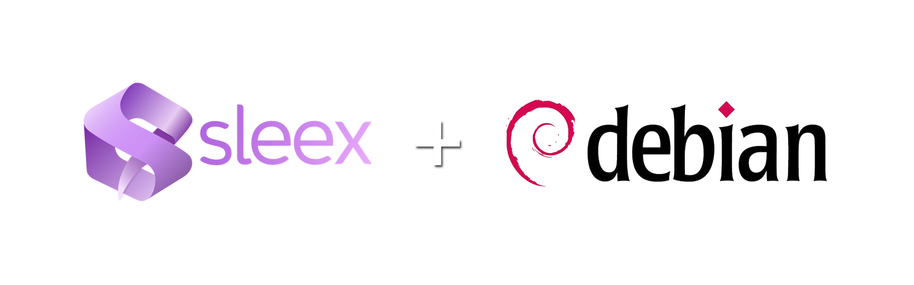

# Sleex on Debian

<h3>Attention : This is for fun, there is no guaranteed it will work on your device and there is NO UNINSTALL option yet, PLEASE USE AT YOUR OWN RISK</h3>



**English** | [ภาษาไทย](README_TH.md)

Installer for the [Sleex](https://github.com/AxOS-project/Sleex) desktop (AxOS, Hyprland + Quickshell) on Debian-based distros.

> [!NOTE]
> Tested on real hardware: **PikaOS 4** (Debian sid, Hyprland 0.57), installed side by side with PikaOS's own desktop without removing anything.
>
> Plain Debian 13 / testing / sid has not been tested yet.

## Requirements

- amd64 (x86_64)
- Hyprland **≥ 0.55** (Sleex uses the Lua config format)
- Quickshell and Qt ≥ 6.8

| Distro | Status |
|---|---|
| PikaOS 4 | ✅ Tested |
| Debian 13 (trixie) | ⚠️ Untested (`trixie-backports` is enabled automatically) |
| Debian testing / sid | ⚠️ Untested |
| Ubuntu / Mint | ❌ Repo Hyprland is older than 0.55 (the script stops early) |

## Usage

```bash
git clone https://github.com/Moxier/sleex-debian
cd sleex-debian
sudo ./install-sleex-debian.sh 2>&1 | tee install.log
```

Then log out and choose the **Sleex** session in your display manager.

If something goes wrong, attach `install.log` when you open an issue.

## Updating

The script always installs the latest Sleex from GitHub, so updating means running it again:

```bash
cd ~/sleex-debian && git pull
sudo ./install-sleex-debian.sh 2>&1 | tee install.log
```

- **Overwritten:** Sleex's own files in `/usr/share/sleex`, `/etc/sleex` and `/usr/bin/sleex`
- **Kept:** everything in your home, including `~/.config/sleex/custom/*.lua`, wallpapers and colours
- Hyprland, Quickshell and other packages update through apt as usual

If upstream Sleex changes the code a patch targets, that patch may stop applying. The keyboard patch stops the script with an error; the others skip silently and only that feature stops working.

## Thai keyboard (Alt+Space)

Put this in `~/.config/sleex/custom/general.lua` (loaded after the main config and never overwritten by updates):

```lua
hl.config({
    input = {
        kb_layout = "us,th",
        kb_variant = ",",
        kb_options = "grp:alt_space_toggle",
    },
})
```

Then log out and back in, or run `hyprctl reload`. Without this, Sleex reads the layout from `/etc/default/keyboard`. Swap `th` for any other XKB layout code.

## What the script does

1. Checks the Hyprland / Quickshell / Qt versions first and stops if they are too old
2. Installs the dependencies from the Arch PKGBUILD, mapped to Debian package names
   - Packages missing from your repos are skipped
   - **Packages that would remove something you already have are skipped** (e.g. on PikaOS, `power-profiles-daemon` conflicts with `tuned-ppd`)
   - Everything skipped is listed at the end
3. Builds from source: the Sleex QML plugins, `sleex-ui-kit`, `sleex-welcome-screen`, `hypnos`
4. Downloads what Arch gets from the AUR: matugen, Bibata cursor, adw-gtk3 theme, fonts (Material Symbols, Gabarito, Rubik, Readex Pro, JetBrains Mono Nerd), hyprshot, papirus-folders
5. Debian patches:
   - Reads the keyboard layout from `/etc/default/keyboard` instead of Arch's `/etc/vconsole.conf`
   - `qt_standard_project_setup(REQUIRES 6.9)` → 6.8 (only when Qt < 6.9)
   - polkit group `wheel` → `sudo`
   - A separate venv for `materialyoucolor` (no system-wide pip)
   - The power saver button uses `busctl` instead of `powerprofilesctl` when the system uses `tuned-ppd`
   - Runs `Hyprland` directly if `start-hyprland` is missing
6. Copies the default config into the sudo user's home **without overwriting existing files**

## Troubleshooting

**Icons/theme missing in the file manager** — if `~/.config/qt6ct/qt6ct.conf` already existed (e.g. from PikaOS), the script leaves it alone, so Qt apps keep an icon theme Sleex may not find. Fix it with the commands below. This also changes your other desktop, since both share the file:

```bash
cp ~/.config/qt6ct/qt6ct.conf ~/.config/qt6ct/qt6ct.conf.bak
sed -i 's/^icon_theme=.*/icon_theme=Papirus-Dark/; s/^style=.*/style=kvantum/' ~/.config/qt6ct/qt6ct.conf
```

**Flatpak apps not in the launcher** — if you installed a Flatpak app while Sleex was running, log out and back in.

## Known limitations

- If the Sleex plugins use Qt 6.9-only APIs, they won't build on Debian 13 (testing/sid are fine)
- The Lua config API in Hyprland 0.55 (backports) may differ from the version AxOS targets
- `hypnos` may fail to build if Debian's Rust is too old → idle/auto-lock won't work (the script warns and continues)
- Not included: Howdy (face unlock), Mission Center, breeze-plus, an uninstall script

## License

GPL-3.0, same as upstream Sleex.
